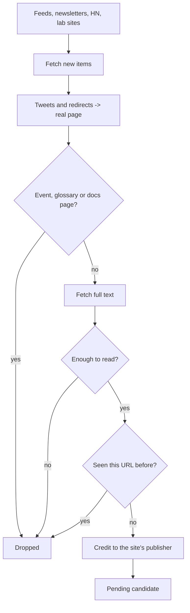
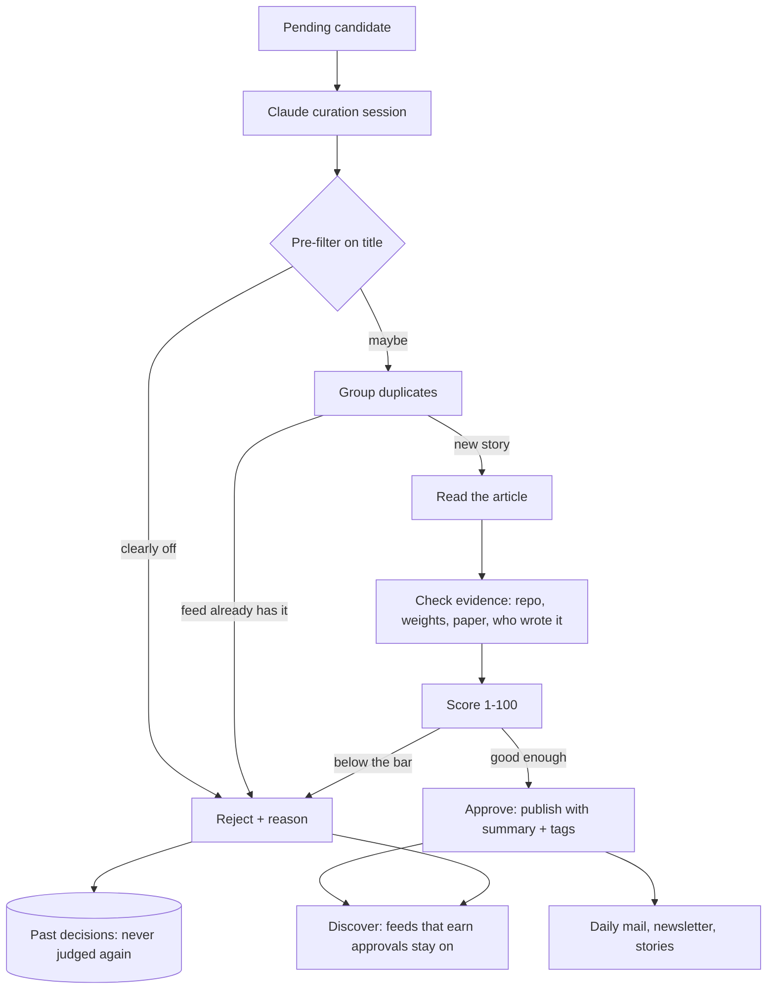
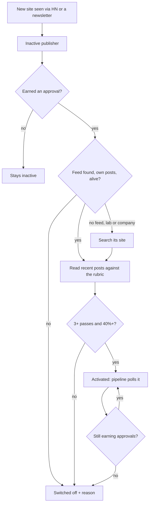

# agentique

A curated feed of articles for people building with AI. A nightly pipeline collects candidates; a Claude Code session reads them and decides what gets published.

## Pipeline

Runs daily at 04:00. Collects, judges nothing.

- Fetch new items from feeds, newsletters, Hacker News and lab sites
- Follow tweets and redirect links to the real page
- Drop event, glossary and docs pages
- Fill in the full text; drop items with too little to read
- Drop URLs already published, rejected or waiting
- Credit each item to the site it is on, not where it was found
- Queue the rest as pending candidates

## Curation

A Claude Code session after the pipeline. Decides every candidate.

- Reject the clear misses on title alone: off topic, funding, vendor product posts, digests
- Group copies of one story; reject the ones the feed already carries
- Read the rest and check the evidence: repo, model weights, paper, who wrote it
- Score 1-100 on evidence and reach
- Approve: publish with summary and tags; or reject with a reason
- Every verdict is kept, so no URL is judged twice

## Discover publishers

A daily Claude Code session. Decides which sites the pipeline polls; publishes nothing.

- Hacker News and newsletters surface new sites; each becomes an inactive publisher
- Turn off polled feeds that stopped earning approvals: none in 10+ decisions, under 5% over 30+, or silent for 120 days (aggregators are never deactivated)
- Probe inactive publishers that have earned an approval: find their feed, check it is their own posts and still alive
- Read their recent posts and judge each against the curation rubric (passes at 70+)
- Activate at 3+ passes and a 40%+ pass rate; otherwise switch off with the reason
- No feed: a lab or company is searched on its own site instead; anyone else stays off

## Search

- One query box matches by keyword: Postgres full-text over title, summary, body and tag names, so an exact name like "vLLM" matches
- Filters (tags, kinds, publisher, date) narrow the articles before ranking

## Newsletter

- Signing up takes only an email: it makes the account, adds the address to the Resend audience, and mails a sign-in link (no passwords)
- Every Friday a Claude Code session drafts the issue: 10-12 of the week's most useful articles, liked ones first, in 3-4 sections with a one-line summary each
- The same file is the email and a blog post in `frontend/content/blog/`
- It lands as a Resend draft; a person sends it

## API and MCP

- The article endpoints (list, search, facets, publishers, tags, stats) are public: no account, no rate limit, no date window
- A token is optional and only fills in `liked_by_me`
- An MCP server at `/mcp` gives coding agents `search_articles`, `list_tags` and read-only `sql_query` over the archive
- A signed-in reader makes an MCP token at `/connect-mcp` and copies the config for Claude Code, OpenCode, Cursor, Codex CLI or VS Code

## Stack

- PostgreSQL + pgvector - the only Docker container (`docker compose up -d`)
- FastAPI backend, REST API and MCP server - native via uv, systemd in production
- Pipeline - native via uv, systemd timer
- React + Vite + Tailwind frontend - static files served by Caddy
- model2vec - embeddings for spotting the same story across publishers

## Docs

- [Backend](./docs/backend.md)
- [Frontend](./docs/frontend.md)
- [Glossary](./docs/glossary.md)
- [Deployment](./deploy/README.md)
